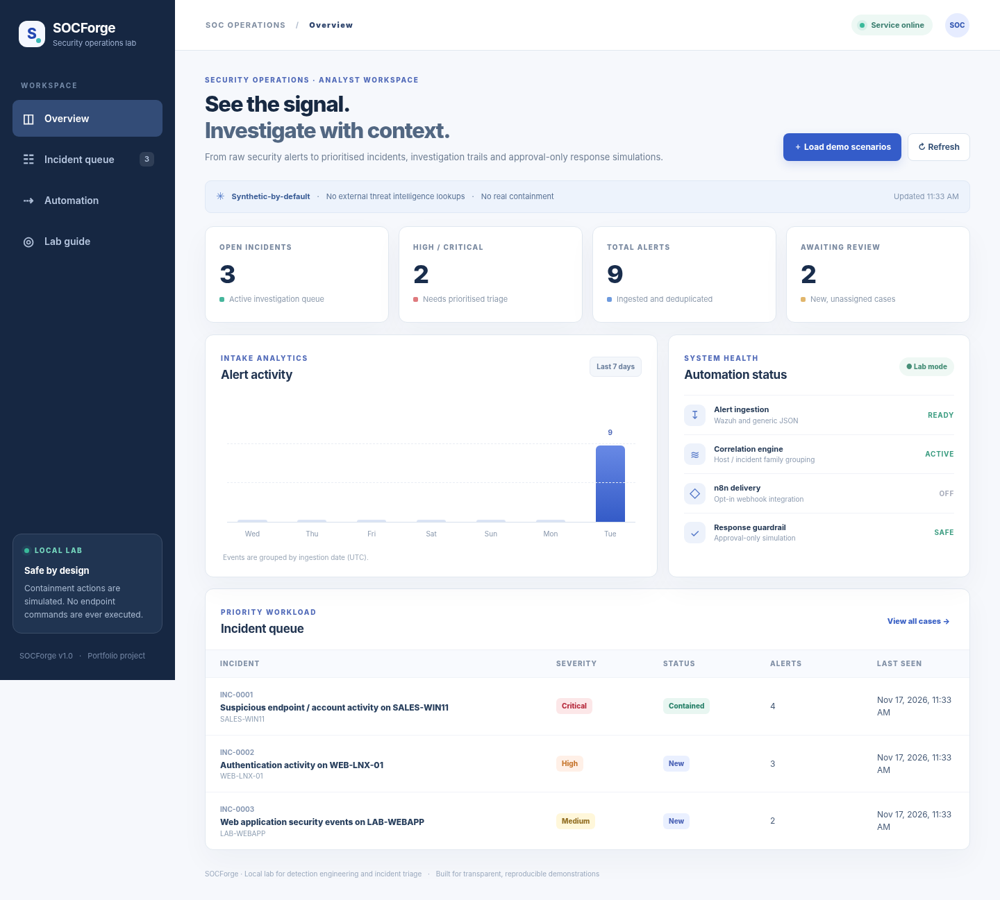

# SOCForge — SOC Alert Triage & Response Simulation Lab

**An actual runnable local web application, not a static mock-up.**

SOCForge ingests JSON security alerts, converts them to normalised records, deduplicates events, correlates related alerts into incidents, applies explainable risk scores, and gives SOC analysts a browser dashboard for investigation, notes, status changes and case reports. It optionally forwards incident notifications to an n8n webhook and includes a Wazuh Integrator adapter. There are no real blocking, isolation or endpoint response commands.



## Fastest start

**Windows:** Install Python 3.10+ if needed, unzip this folder, then double-click **`start_windows.bat`**. The first launch installs three Python dependencies. Open **http://127.0.0.1:8080**.

**Linux / macOS:** Install Python 3.10+, then run:

```bash
chmod +x start_linux.sh
./start_linux.sh
```

**Docker alternative:** `docker compose up --build`, then open **http://127.0.0.1:8080**. Docker is an alternative to local Python, not a requirement.

**Demo:** Click **Load demo scenarios**. SOCForge creates **9 synthetic alerts grouped into 3 incidents**. Click a case, investigate its timeline, change the status, add a note, request and approve a *simulation* and download the Markdown case report. Re-importing the same demo events does not duplicate them.

No Azure account, live SIEM, API key or threat-intelligence subscription is required for the built-in demo. Requires a local computer with Python/Docker. No public hosting is provided.

## Implemented in version 1.0

- REST endpoint `POST /api/alerts` for generic and Wazuh-style JSON payloads, up to 50 alerts per request
- Deterministic event deduplication; 60-minute correlation by host and detection family
- Explainable scoring using Wazuh rule severity, event types, correlated activity and available IP context
- MITRE ATT&CK *reference hypotheses*, not claims of confirmed attacker intent
- Web dashboard with severity and status filters, case timeline, risk factors, IOC context, analyst assignment and notes
- Request/approve *simulated* containment; audit log records approval; **never executes containment**
- Downloadable Markdown incident reports
- Persistent SQLite database (path configurable); 7-day alert activity chart
- Optional outbound JSON webhook to n8n with delivery results
- Wazuh integration script and n8n workflow template (setup required; these are not bundled live services)
- Automated API tests and a browser UI smoke test, using synthetic scenarios

## What this is NOT

This is a **portfolio/lab prototype**. It is not a production SIEM, EDR, malware scanner, forensic product or deployable enterprise SOAR. It does not query VirusTotal, AbuseIPDB or Azure on its own and does **not** block IPs or isolate machines. Wazuh/n8n **integration adapters are provided but require your real systems to validate live integration**. The demo IP addresses are private or documentation-only, and they are not indicators of genuine attacks.

## API

Visit **http://127.0.0.1:8080/docs** to view Swagger API documentation.

### One example alert (generic)

```bash
curl -X POST http://127.0.0.1:8080/api/alerts \
  -H "Content-Type: application/json" \
  -d '{"id":"manual-001","source":"test","host":"LAB-WIN01","level":10,"category":"privilege_change","title":"Test admin group membership change"}'
```

To send the included Wazuh-shaped test alert:

```bash
python integrations/send_sample_wazuh.py
```

Set `SOCFORGE_API_KEY` in the environment to protect the ingestion endpoint, then supply the key using `X-API-Key`. See `docs/INTEGRATIONS.md` and `.env.example`. The UI's local demo endpoint is independent of the optional ingestion API key.

## Security and scope

- Python startup binds to `127.0.0.1` only; Docker Compose binds the host-side port to `127.0.0.1`.
- **Do not expose this demo application directly to the public internet.** The incident dashboard and case-change endpoints have no login system, role-based access control or TLS.
- Do not load customer secrets, live personal data, private indicator feeds or raw production logs into the public portfolio demo.
- Do not add an unreviewed endpoint response action. Approval buttons are intentionally simulation-only.
- Outbound n8n notifications are OFF by default.
- Data persists in `data/socforge.db` or the Docker named volume. The demo reset removes only alerts tagged `demo`.

## Project structure

```text
app/                FastAPI backend, correlation/risk engine, SQLite, frontend
examples/           9 synthetic alerts + one Wazuh-shaped example
integrations/       Wazuh Integrator script, n8n workflow JSON, sample sender
tests/              API tests + interactive browser smoke test
screenshots/        Captured from the running UI against a real in-process API
docs/               Project plan, integration instructions, portfolio text, test report
run.py              Loopback-only Python launcher
start_windows.bat   One-step Windows start
start_linux.sh      One-step Linux/macOS start
Dockerfile          Optional container image
compose.yaml        Loopback-only container deployment
```

## Tests

```bash
python -m pip install -r requirements-dev.txt
python -m pytest
```

The browser smoke test uses `/usr/bin/chromium` in the authoring environment; it is optional for users and not required to run SOCForge. See `docs/TEST_REPORT.md` for exactly what was checked.

## License / credits

This is a standalone original proof-of-concept project intended for ethical training and portfolio use. MITRE ATT&CK names/IDs are used as framework references. No vendor logos, attack data or product code are included. Review `LICENSE` before redistribution.

## Port already in use?

For a local Python launch on Linux/macOS, set `SOCFORGE_PORT=8765` before starting. On Windows, in Command Prompt, use `set SOCFORGE_PORT=8765` followed by `python run.py`. The UI will then be available on `http://127.0.0.1:8765`. For Docker, adjust the left-side port in `compose.yaml`.
